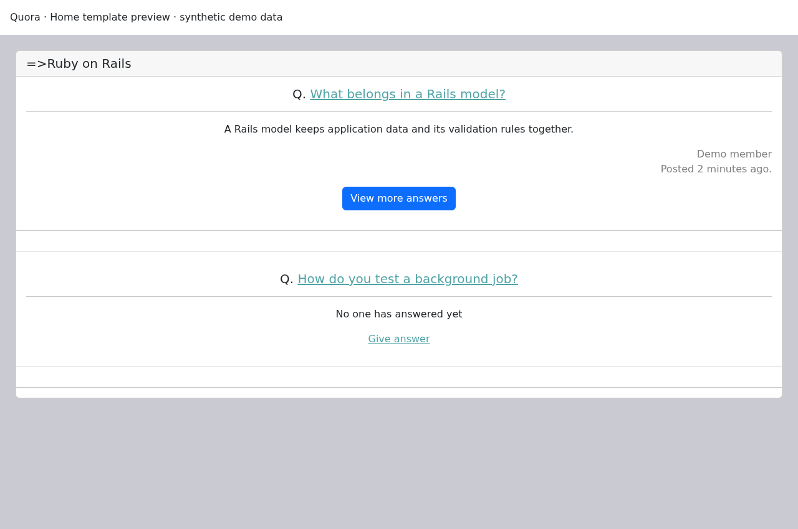
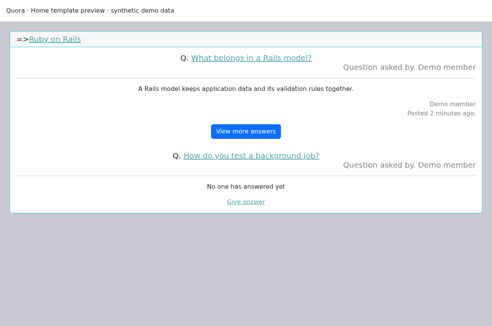

# Quora — Rails Q&A application


A Quora-inspired question-and-answer application built with Ruby on Rails and PostgreSQL.

## Features

- Questions and answers organised by topic
- Devise accounts, profiles and user follows
- Topic following and notifications
- Chat rooms and messages
- CKEditor rich-text editing

## Screenshots: home-template previews

These images render the actual `app/views/static_pages/home.html.erb` with synthetic questions, answers and a demo member. They show the guest/member content states, not a live deployment or verified end-to-end session. The surrounding application navigation is omitted.




## Requirements

- Ruby **3.0.0** and Bundler **2.3.22**, matching the Gemfile and lockfile
- PostgreSQL and Redis running locally
- PostgreSQL/SQLite development headers; ImageMagick for image processing

This is a legacy learning project. Its pinned Ruby/Rails versions need a separate upgrade before production use.

## Local setup

```sh
git clone https://github.com/Divyarajsinhsolanki/Quora.git
cd Quora
gem install bundler -v 2.3.22
bundle _2.3.22_ install
export DATABASE_URL=postgresql://localhost/quora_local_development
bundle exec rails db:create db:schema:load
bundle exec rails server
```

Open <http://localhost:3000> and register a local test account. The URL assumes your operating-system user has a local PostgreSQL role with database-creation permission; adjust it for your local connection. Use a fresh development database. These commands do not load repository seeds or imported data.

Development Action Cable uses Redis at `redis://localhost:6379/1`. JavaScript uses import maps, so there is no npm install step. Keep credentials in local environment variables or Rails credentials, never tracked files.

Optional billing code requires your own `STRIPE_SECRET_KEY` and `STRIPE_PUBLISHABLE_KEY`. CI does not provide payment credentials. Previously committed keys must be revoked; changing configuration does not revoke them.

## Tests

Use a **separate disposable test database**:

```sh
export RAILS_ENV=test
export DATABASE_URL=postgresql://localhost/quora_local_test
bundle exec rails db:create db:schema:load
bundle exec rails test
```

GitHub Actions runs the existing Rails test suite on pushes and pull requests using isolated PostgreSQL and Redis services. It does not deploy, publish packages or use production credentials. Browser system tests are not included in this initial workflow. Existing test failures remain visible rather than being skipped.

## Project layout

- `app/models`, `app/controllers`, `app/views`: application code and screens
- `app/channels`: Action Cable channels
- `db/schema.rb`: database structure
- `test/`: Rails tests and fixtures
- `.github/workflows/tests.yml`: continuous integration

## Licence

No licence grant is currently included. Contact the owner before reuse or redistribution.
